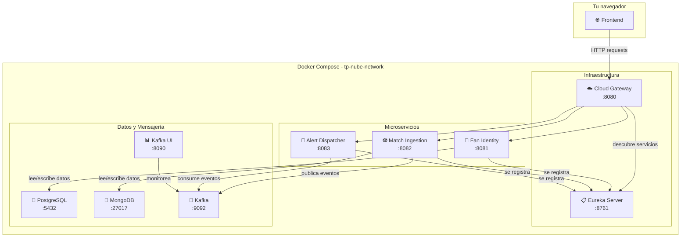

# 🐳 Explicación del archivo `docker-compose.yml`

> [!NOTE]
> Este documento explica de forma sencilla qué hace cada parte del archivo [`docker-compose.yml`](file:///c:/dev/TP-DAN/docker-compose.yml) del proyecto **TP-DAN**, pensado para alguien que **nunca usó Docker**.

---

## ¿Qué es Docker y Docker Compose?

Imaginá que para correr este proyecto necesitás instalar manualmente una base de datos PostgreSQL, otra base de datos MongoDB, un sistema de mensajería llamado Kafka, y varios programas Java (microservicios). Instalar y configurar todo eso en tu computadora llevaría horas y sería propenso a errores.

**Docker** resuelve esto: empaqueta cada programa en una "caja" aislada llamada **contenedor**. Cada contenedor trae todo lo que necesita para funcionar (el programa, sus dependencias, su configuración), sin que afecte nada de lo que tenés instalado en tu máquina.

**Docker Compose** es una herramienta que permite definir **todos esos contenedores en un solo archivo** (`docker-compose.yml`) y levantarlos con un único comando:

```bash
docker compose up
```

---

## Estructura general del archivo

El archivo tiene **tres secciones principales**:

| Sección | ¿Qué define? |
|---|---|
| `networks` | La red virtual donde se comunican los contenedores entre sí |
| `volumes` | Los "discos virtuales" para que los datos persistan aunque se borren los contenedores |
| `services` | Cada programa (contenedor) que se va a ejecutar |

---

## 🌐 Redes (`networks`)

```yaml
networks:
  tp-nube-network:
    driver: bridge
```

Se crea una **red virtual privada** llamada `tp-nube-network`. Todos los contenedores del proyecto se conectan a esta red para poder "verse" entre ellos por nombre. Por ejemplo, el microservicio `fan-identity-service` puede conectarse a la base de datos simplemente usando el nombre `postgres`, sin necesidad de saber su dirección IP.

El driver `bridge` es el tipo de red estándar de Docker: permite que los contenedores se comuniquen entre sí pero están aislados del resto de tu computadora.

---

## 💾 Volúmenes (`volumes`)

```yaml
volumes:
  postgres-data:
  mongo-data:
  kafka-data:
```

Los contenedores son **efímeros**: cuando los detenés y borrás, todos los datos que tenían dentro **se pierden**. Los volúmenes solucionan esto creando "discos virtuales" que sobreviven a la destrucción del contenedor.

| Volumen | ¿Qué datos guarda? |
|---|---|
| `postgres-data` | Los datos de la base de datos PostgreSQL (usuarios, cuentas, etc.) |
| `mongo-data` | Los datos de la base de datos MongoDB (partidos, información deportiva) |
| `kafka-data` | Los mensajes del sistema de mensajería Kafka |

---

## ⚙️ Servicios (`services`)

Los servicios están organizados en **tres grupos**. Cada servicio se convierte en un contenedor cuando ejecutás `docker compose up`.

---

### 🗄️ Grupo 1: Infraestructura de datos y mensajería

Estos son los servicios "de soporte" que almacenan datos o permiten la comunicación entre microservicios.

---

#### `postgres` — Base de datos relacional

```yaml
image: postgres:16-alpine
```

- **¿Qué es?** [PostgreSQL](https://www.postgresql.org/) es una base de datos relacional (tipo tabla, con filas y columnas). Acá se guardan los datos estructurados del proyecto, como la información de los fans/usuarios.
- **`image: postgres:16-alpine`**: Usa una imagen prearmada de PostgreSQL versión 16 en su variante "alpine" (una versión más liviana).
- **`environment`**: Configura la base de datos con:
  - Nombre de la base: `fan_identity_db`
  - Usuario: `fan_admin`
  - Contraseña: `fan_pass123`
- **`ports: "5432:5432"`**: Expone el puerto 5432 (el estándar de PostgreSQL) en tu máquina, para que puedas conectarte desde herramientas externas (como DBeaver o pgAdmin).
- **`volumes`**: Conecta el volumen `postgres-data` para que los datos no se pierdan al reiniciar.
- **`healthcheck`**: Docker verifica periódicamente que PostgreSQL esté funcionando. Si no responde, lo marca como "no saludable".

---

#### `mongo` — Base de datos de documentos

```yaml
image: mongo:7
```

- **¿Qué es?** [MongoDB](https://www.mongodb.com/) es una base de datos NoSQL orientada a documentos (guarda datos en formato parecido a JSON en lugar de tablas). Se usa para almacenar información de partidos deportivos.
- **`image: mongo:7`**: Usa MongoDB versión 7.
- **`ports: "27017:27017"`**: Expone el puerto estándar de MongoDB.
- **`volumes`**: Conecta `mongo-data` para persistir los datos.
- **`healthcheck`**: Verifica que MongoDB responda a un "ping".

---

#### `kafka` — Sistema de mensajería

```yaml
image: apache/kafka:3.9.0
```

- **¿Qué es?** [Apache Kafka](https://kafka.apache.org/) es un sistema de mensajería. Funciona como un "buzón de correo" entre microservicios: un servicio publica un mensaje (por ejemplo, "se creó un nuevo partido") y otro servicio lo recibe y actúa en consecuencia (por ejemplo, "enviar una alerta a los fans").
- **¿Por qué se usa?** Permite que los microservicios se comuniquen de forma **asincrónica** (no necesitan estar disponibles al mismo tiempo). Si un servicio está caído temporalmente, los mensajes se guardan en Kafka hasta que pueda procesarlos.
- **`ports: "9092:9092"`**: Expone Kafka en el puerto 9092 para que puedas conectarte desde tu máquina.
- **`environment`**: Toda la configuración técnica de Kafka. Los detalles son avanzados, pero básicamente le dicen a Kafka que funcione en modo "single node" (un solo nodo, adecuado para desarrollo).

---

#### `kafka-ui` — Panel visual para Kafka

```yaml
image: provectuslabs/kafka-ui:latest
```

- **¿Qué es?** Una interfaz web que te permite **ver gráficamente** lo que pasa dentro de Kafka: qué mensajes se enviaron, qué temas (topics) existen, etc.
- **`ports: "8090:8080"`**: Accedés desde tu navegador en [http://localhost:8090](http://localhost:8090).
- **`depends_on`**: Solo se inicia **después** de que Kafka esté funcionando correctamente (condición: `service_healthy`).

---

### ☁️ Grupo 2: Infraestructura Spring Cloud

Estos servicios manejan la **arquitectura de microservicios**: cómo se descubren entre sí y cómo llegan las peticiones del exterior.

---

#### `eureka-server` — Registro y descubrimiento de servicios

```yaml
build:
  context: ./backend-app/infrastructure/eureka-server
```

- **¿Qué es?** [Eureka](https://spring.io/projects/spring-cloud-netflix) es como una "guía telefónica" para microservicios. Cada microservicio, cuando se inicia, se registra en Eureka diciendo "soy el servicio X y estoy en esta dirección". Así, cuando un servicio necesita comunicarse con otro, le pregunta a Eureka dónde encontrarlo.
- **`build`**: A diferencia de los servicios anteriores que usan imágenes prearmadas (`image:`), este se **construye localmente** desde el código fuente ubicado en `./backend-app/infrastructure/eureka-server`.
- **`ports: "8761:8761"`**: Podés ver el panel de Eureka en [http://localhost:8761](http://localhost:8761) para verificar qué servicios están registrados.
- **`EUREKA_CLIENT_REGISTERWITHEUREKA: "false"`**: Como Eureka es el propio registro, no necesita registrarse en sí mismo.

---

#### `cloud-gateway` — Puerta de entrada (API Gateway)

```yaml
build:
  context: ./backend-app/infrastructure/cloud-gateway
```

- **¿Qué es?** El Gateway es la **puerta de entrada única** a toda la aplicación. En lugar de que el frontend tenga que saber la dirección de cada microservicio, todas las peticiones van al Gateway (`localhost:8080`) y este las redirige internamente al microservicio correspondiente.
- **`ports: "8080:8080"`**: El frontend se conecta a [http://localhost:8080](http://localhost:8080).
- **`depends_on`**: Espera a que **todos los microservicios y Eureka** estén saludables antes de iniciar, porque necesita saber a dónde redirigir las peticiones.

---

### 🏗️ Grupo 3: Microservicios de negocio

Estos son los servicios que implementan la **lógica de la aplicación**.

---

#### `fan-identity-service` — Gestión de identidad de fans

```yaml
build:
  context: ./backend-app/microservices/fan-identity-service
```

- **¿Qué hace?** Maneja todo lo relacionado con los **usuarios/fans**: registro, autenticación, perfiles, etc.
- **Base de datos**: Se conecta a **PostgreSQL** (`postgres:5432/fan_identity_db`) usando las credenciales configuradas.
- **`SPRING_JPA_HIBERNATE_DDLAUTO: update`**: Crea/actualiza automáticamente las tablas en la base de datos según los modelos de datos definidos en el código Java.
- **`depends_on`**: Necesita que **PostgreSQL** y **Eureka** estén saludables antes de iniciar.
- **Puerto interno**: 8081 (no se expone directamente; se accede a través del Gateway).

---

#### `match-ingestion-service` — Ingesta de partidos

```yaml
build:
  context: ./backend-app/microservices/match-ingestion-service
```

- **¿Qué hace?** Se encarga de la **ingesta y gestión de datos de partidos deportivos**.
- **Base de datos**: Se conecta a **MongoDB** (`mongo:27017/match_ingestion_db`) para guardar la información de partidos en formato de documentos.
- **Mensajería**: Se conecta a **Kafka** (`kafka:19092`) para publicar eventos cuando se ingesta un gol, tarjeta o fin de partido.
- **`depends_on`**: Necesita que **MongoDB**, **Kafka** y **Eureka** estén saludables.
- **Puerto interno**: 8082.

> [!WARNING]
> La variable se llama `SPRING_MONGODB_URI`, no `SPRING_DATA_MONGODB_URI`. En Spring Boot 4 la property de conexión a Mongo cambió de nombre (`spring.data.mongodb.uri` → `spring.mongodb.uri`) y la vieja quedó deprecada a nivel `error`: ya no se bindea, así que el driver ignoraría esta variable y probaría conectarse a `localhost` dentro del contenedor. Se detectó y corrigió en T-20 (R-8).

---

#### `alert-dispatcher-service` — Despacho de alertas

```yaml
build:
  context: ./backend-app/microservices/alert-dispatcher-service
```

- **¿Qué hace?** **Escucha mensajes de Kafka** y despacha alertas/notificaciones a los fans. Por ejemplo, cuando `match-ingestion-service` publica un evento de nuevo partido, este servicio lo recibe y notifica a los usuarios interesados.
- **Mensajería**: Se conecta a **Kafka** para consumir eventos.
- **`depends_on`**: Necesita que **Kafka** y **Eureka** estén saludables.
- **Puerto interno**: 8083.

> [!TIP]
> Notá que este servicio **no tiene base de datos propia**. Solo escucha mensajes y actúa, lo cual es un patrón común en arquitecturas orientadas a eventos.

---

## 🏗️ `image:` vs `build:` — imágenes prearmadas vs. imágenes propias

En el archivo conviven **dos formas** de obtener la imagen de un contenedor:

| Forma | Servicios | ¿De dónde sale la imagen? |
|---|---|---|
| `image: nombre:version` | `postgres`, `mongo`, `kafka`, `kafka-ui` | Se **descarga ya armada** desde Docker Hub (un repositorio público de imágenes) |
| `build: { context: ./ruta }` | `eureka-server`, `cloud-gateway`, `fan-identity-service`, `match-ingestion-service`, `alert-dispatcher-service` | Se **construye en tu máquina** a partir del código fuente, siguiendo las instrucciones de un archivo `Dockerfile` |

Los servicios de infraestructura (bases de datos, Kafka) son software estándar que nadie modifica, así que se usa la imagen oficial tal cual. En cambio, los 5 servicios de Java **son código nuestro**: no existe una imagen publicada con ellos, hay que compilarlos y empaquetarlos.

### ¿Qué hace `build:`?

```yaml
build:
  context: ./backend-app/microservices/fan-identity-service
```

`context` es la **carpeta** que Docker toma como base para construir. Dentro de esa carpeta busca —por convención, sin necesidad de nombrarlo— un archivo llamado **`Dockerfile`** con la receta de construcción. Cuando corrés `docker compose up --build`, Docker ejecuta esa receta y genera una imagen local con la aplicación adentro.

### El `Dockerfile` de cada servicio Java (build multi-etapa)

Los 5 Dockerfiles son casi idénticos (solo cambia el puerto del `EXPOSE`). Usan una técnica llamada **build multi-etapa** (*multi-stage build*), que tiene dos partes:

```dockerfile
# --- Etapa 1: build con Maven ---
FROM maven:3.9-eclipse-temurin-25 AS build
WORKDIR /app
COPY pom.xml .
RUN mvn -B dependency:go-offline      # descarga las dependencias (se cachea)
COPY src ./src
RUN mvn -B clean package -DskipTests  # compila y genera el .jar

# --- Etapa 2: runtime liviano ---
FROM eclipse-temurin:25-jre-jammy
WORKDIR /app
COPY --from=build /app/target/*.jar app.jar   # se trae SOLO el .jar de la etapa 1
EXPOSE 8081
ENTRYPOINT ["java", "-jar", "app.jar"]
```

- **Etapa 1 (`build`)**: parte de una imagen que trae **Maven + el JDK completo**. Copia primero solo el `pom.xml` y baja las dependencias (ese paso queda cacheado, así que si no cambian las dependencias no se vuelven a descargar en cada build). Después copia el código (`src`) y ejecuta `mvn clean package`, que compila el proyecto y produce el archivo `.jar` ejecutable. Se saltean los tests (`-DskipTests`) para que el build sea más rápido.
- **Etapa 2 (runtime)**: parte de una imagen mucho más chica que **solo trae el JRE** (lo justo para *ejecutar* Java, sin Maven ni compilador). Con `COPY --from=build` se trae únicamente el `.jar` generado en la etapa anterior y se descarta todo lo demás (el código fuente, las dependencias de Maven, las herramientas de compilación).

**¿Por qué en dos etapas?** Para que la imagen final sea liviana y segura. Si se usara una sola etapa, la imagen quedaría con Maven, el JDK y todo el código fuente adentro (cientos de MB extra que no hacen falta para correr la app). Con el multi-stage, la imagen final pesa lo mínimo: un JRE + un `.jar`.

- **`EXPOSE 8081`**: es solo **documentación** de qué puerto usa la app dentro del contenedor (cambia según el servicio: 8761, 8080, 8081, 8082, 8083). No publica el puerto hacia tu máquina — eso lo hace `ports:` en el `docker-compose.yml`.
- **`ENTRYPOINT ["java", "-jar", "app.jar"]`**: el comando que se ejecuta al arrancar el contenedor. Simplemente lanza la aplicación Spring Boot.

> [!TIP]
> `docker compose up` sin `--build` reutiliza la última imagen construida. Si cambiaste código Java y querés que se refleje, usá `docker compose up --build` (o `docker compose build <servicio>` para reconstruir solo uno).

---

## 🔗 ¿Cómo se conecta todo?



---

## 📌 ¿Qué significa `healthcheck`?

Todos los servicios tienen un bloque `healthcheck`. Esto le dice a Docker **cómo verificar que el servicio esté funcionando correctamente**:

| Propiedad | Significado |
|---|---|
| `test` | El comando que Docker ejecuta para verificar la salud |
| `interval` | Cada cuánto tiempo se ejecuta la verificación (ej: cada 10 segundos) |
| `timeout` | Cuánto tiempo esperar por una respuesta antes de dar la verificación como fallida |
| `retries` | Cuántas veces puede fallar antes de marcar el servicio como "no saludable" |
| `start_period` | Tiempo de gracia al inicio (no cuenta fallos durante este período) |

Esto es clave porque los `depends_on` con `condition: service_healthy` usan estos healthchecks para **no iniciar un servicio hasta que sus dependencias estén realmente listas**.

**Caso particular — `kafka` con `timeout: 12s`:** el resto de los servicios usan `5s`, pero el comando que chequea a Kafka (`kafka-broker-api-versions.sh`) levanta su propia JVM cliente para consultar al broker, y eso solo tarda unos ~7 segundos. Con `5s` el healthcheck fallaba siempre (no por falta de recursos de la máquina, el comando corriendo a mano tarda lo mismo), así que `kafka` quedaba `unhealthy` de forma permanente y bloqueaba a `alert-dispatcher-service` y `match-ingestion-service` (que dependen de que esté `healthy` para arrancar).

---

## 🚀 Comandos útiles

| Comando | ¿Qué hace? |
|---|---|
| `docker compose up` | Levanta todos los servicios (mostrando los logs en la terminal) |
| `docker compose up -d` | Levanta todos los servicios en segundo plano (sin mostrar logs) |
| `docker compose down` | Detiene y elimina todos los contenedores |
| `docker compose down -v` | Igual que el anterior, pero **también borra los volúmenes** (¡borra los datos!) |
| `docker compose logs -f <servicio>` | Muestra los logs de un servicio específico en tiempo real |
| `docker compose ps` | Lista el estado de todos los contenedores |
| `docker compose build` | Reconstruye las imágenes de los servicios que usan `build:` |

---

## 🌍 URLs de acceso local

Una vez que todo esté corriendo, podés acceder a:

| Servicio | URL |
|---|---|
| API Gateway (punto de entrada) | [http://localhost:8080](http://localhost:8080) |
| Eureka (panel de servicios) | [http://localhost:8761](http://localhost:8761) |
| Kafka UI (monitor de mensajes) | [http://localhost:8090](http://localhost:8090) |
