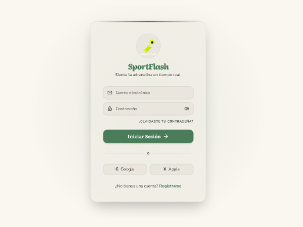
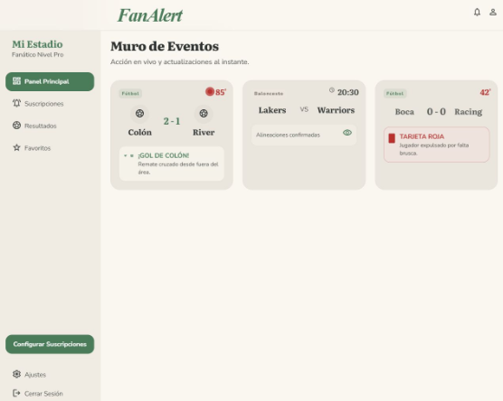
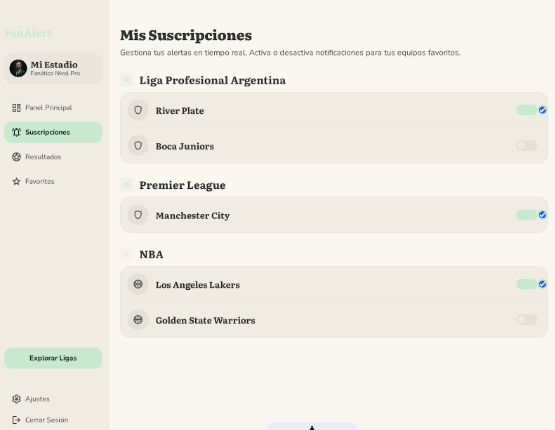
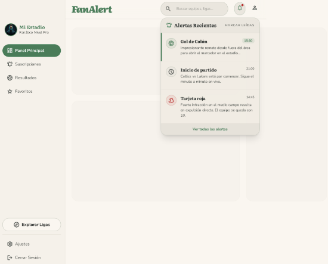

# 1. Propuesta de problema a resolver

En la actualidad, los fanáticos del deporte consumen información de múltiples fuentes (redes sociales, sitios de noticias). Sin embargo, la gran variedad dificulta el seguimiento personalizado de eventos en tiempo real.
El problema a resolver es la dispersión de la información y la falta de un sistema de notificaciones centralizado que permita al usuario reaccionar de forma inmediata ante eventos específicos de su interés (goles, finales de partido, cambios de ranking) sin tener que monitorear activamente diversas fuentes.

# 2. Idea general

Plataforma que centraliza información de eventos deportivos de diversos proveedores y permite a los usuarios configurar suscripciones personalizadas. El sistema procesa flujos de datos en tiempo real y, mediante mensajería asincrónica, despacha alertas a los usuarios interesados según su perfil y preferencias.

# 3. Alcance

Si abordaremos:
- 3.1. Registro y autenticación de usuarios.
- 3.2. Suscripción a equipos/ligas específicos
- 3.3. Despacho de notificaciones internas en la plataforma.

No abordaremos:
- 3.4. Comunicación con otros sistemas que no sean proveedores de información.

# 4. Microservicios necesarios

## 4.1. **Fan-Identity-Service**

*   Responsabilidad: Gestión del ciclo de vida del usuario, perfiles y persistencia de las suscripciones (qué fan sigue a qué equipo). Encargado de la seguridad y emisión de JWT.
*   Tecnologías: Spring Boot, Spring Security, JWT.
*   Base de Datos: PostgreSQL (SQL). Justificación: Los datos de usuarios y la relación muchos-a-muchos con las suscripciones requieren integridad referencial y transaccionalidad.

## 4.2. **Match-Ingestion-Service**

*   Responsabilidad: Actuar como el *gateway* de datos externos. Ingesta resultados y eventos. Valida el formato de los mensajes entrantes y los persiste para consulta histórica.
*   Tecnologías: Spring Boot.
*   Base de Datos: MongoDB (NoSQL). Justificación: Los eventos deportivos son heterogéneos (un "gol" en fútbol tiene atributos distintos a un "quiebre de servicio" en tenis). Un esquema flexible de documentos es ideal.
*   Comunicación: Emite eventos asincrónicos a través de un Message Broker (RabbitMQ/Kafka) cada vez que se detecta un evento relevante.

## 4.3. **Alert-Dispatcher-Service**

*   Responsabilidad: Consumir los eventos del broker. Por cada evento (ej. Gol de Colón), debe consultar al Fan-Identity-Service quiénes son los usuarios suscritos y generar el registro de la notificación.
*   Tecnologías: Spring Boot, Spring Cloud Stream.
*   Base de Datos: No posee base de datos propia para respetar el principio de *Single Source of Truth*.

Para cumplir con las características requeridas se aplicará el patrón Circuit Breaker en el Alert-Dispatcher-Service. Dado que este servicio necesita consultar continuamente al Fan-Identity-Service para saber a quién notificar, si el servicio de identidades sufre una caída o latencia alta, el Circuit Breaker se abrirá. Esto evitará que el Alert-Dispatcher-Service colapse esperando respuestas y permitirá encolar los eventos fallidos o aplicar un camino de respuesta alternativo hasta que el sistema se recupere.

# 5. Mockup de las pantallas principales

Los siguientes Mockup fueron generados con la IA Stitch de Google.

* Acceso fan

* Panel Principal

* Panel Mis Suscripciones

* Centro de Alertas

## 6. Roles de usuario y funcionalidades

**Usuario Fan:**

- Registrarse e iniciar sesión.
- Buscar equipos o ligas en el catálogo.
- Gestionar suscripciones (Seguir/Dejar de seguir).
- Visualizar su historial de alertas personalizadas.

**Usuario Administrador:**

- Monitorear el estado de los microservicios.
- Simular la carga de un nuevo evento deportivo para disparar el flujo.